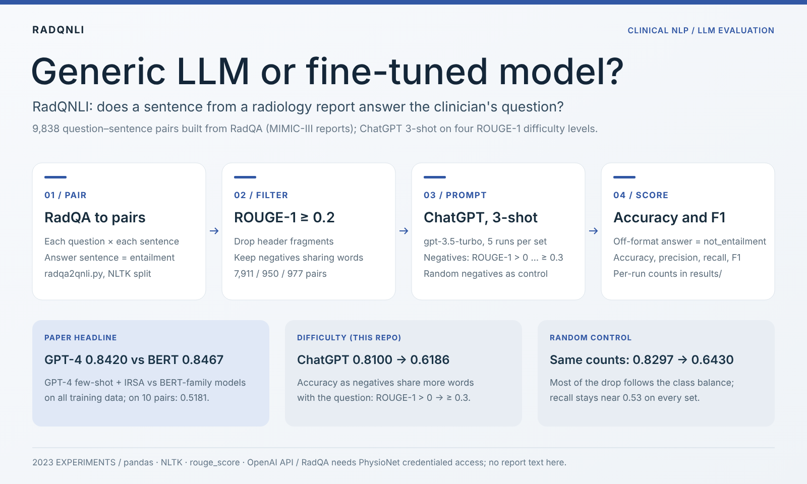
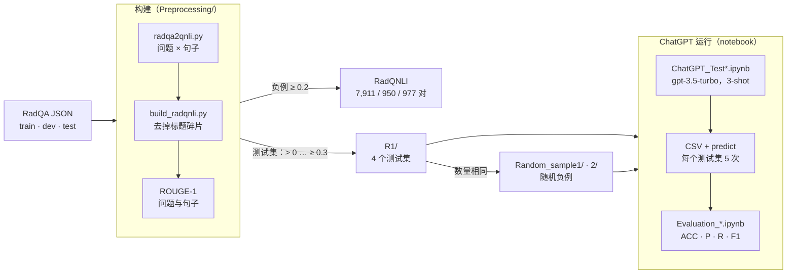

<div align="center">

# RadQNLI

[English](README.md) · **简体中文**

**放射学报告中的一句话，能否回答临床医生提出的问题？这是一个用来权衡“一个通用大模型”与“针对任务微调的模型”的基准。**


-6E7781)
[](https://arxiv.org/abs/2304.09138)
[](https://doi.org/10.1109/TBDATA.2025.3536928)
[](https://www.ccao2679.com/research/#radqnli)



</div>

<!-- problem-framing:start -->

## 问题与依据

> **在不改变评测集类别比例的前提下，当负例变得更难时，问题推理模型是否仍能分辨出支持答案的放射学文本？**

**为什么值得解决：** 模型看起来更强，可能只是因为测试集里的负例更容易，或者类别比例不同。要做可靠的比较，必须把推理难度与抽样效应分开。

**核心矛盾：** 词面相近的负例或许能检验有用的区分能力，但改变负例的选取方式，也可能同时改变主题分布、类别比例和标注歧义。

[完整问题与验证方案](PROBLEM.zh.md) · [English](PROBLEM.md)

<!-- problem-framing:end -->

## 亮点

- **一个可以自行重建的放射学 NLI 基准。** RadQA 把临床医生的问题与 MIMIC-III 放射学报告配在一起（3,074 个问题–报告对，1,009 份报告）。RadQNLI 把每份报告切成句子，再把每个问题与每个句子配对：句子包含答案即为 `entailment`，否则为 `not_entailment`。保留全部 entailment 句对，以及与问题有词语重合的负例（ROUGE-1 ≥ 0.2），共得到 **9,838 对**（4,391 对 entailment，5,447 对 not_entailment）：训练集 7,911、验证集 950、测试集 977。[`build_radqnli.py`](Preprocessing/build_radqnli.py) 能从 RadQA 1.0.0 原样重建这些句对。
- **论文的结论：一个通用模型已经很接近。** 在 IEEE Transactions on Big Data 的论文中，GPT-4 采用 few-shot 提示加 IRSA（instruction-response semantic alignment）达到 **0.8420** 的准确率；用全部训练数据微调的 BERT 系列模型平均为 **0.8467**，而只用 10 个样本训练时平均仅 0.5181。GPT-4、chain-of-thought、IRSA、开源大模型以及微调部分的代码不在本仓库中。
- **本仓库实际运行的实验：ChatGPT 面对四个难度等级。** gpt-3.5-turbo，三个上下文示例，每个测试集运行五次。随着负例与问题共享的词越来越多（ROUGE-1 从 > 0 到 ≥ 0.3），准确率从 **0.8100 降到 0.6186**，即论文表 4 中的曲线。
- **随机对照组解释了大部分下降。** 用同样数量的随机负例，准确率几乎降得一样多（**0.8297 → 0.6430**）。entailment 句对上的召回率在每个测试集上都稳定在 0.52–0.53，因此下降主要来自 entailment 句对占比的上升（21% → 70%）；与同等数量的随机负例相比，词语重合的负例只多带来 2–4 个百分点的准确率损失。如何把这两种因素分开，正是 [PROBLEM.zh.md](PROBLEM.zh.md) 提出的问题。
- **本仓库不含任何报告文本。** RadQA 及其派生内容已从整个 git 历史中移除；[`examples/`](examples/) 用两份虚构的报告演示完整流程。

## 结果

ChatGPT（gpt-3.5-turbo），三个上下文示例，五次运行取平均；数值为准确率 / F1，以 `entailment` 为正类。每个测试集都包含 RadQA 测试划分中的全部 460 对 entailment 句对。

| 测试集 | 负例 | 句对数（entailment + not） | entailment 占比 | ROUGE 过滤负例（`R1/`） | 随机负例，数量相同（`Random_sample1/`） | 随机负例，每个问题数量相同（`Random_sample2/`） |
|---|---|---|---:|---:|---:|---:|
| `test_00` | ROUGE-1 > 0 | 460 + 1,681 | 21% | 0.8100 / 0.5462 | 0.8297 / 0.5743 | 0.8268 / 0.5666 |
| `test_01` | ROUGE-1 ≥ 0.1 | 460 + 1,327 | 26% | 0.7934 / 0.5685 | 0.8121 / 0.5941 | 0.8108 / 0.5872 |
| `test_02` | ROUGE-1 ≥ 0.2 | 460 + 517 | 47% | 0.6986 / 0.6224 | 0.7339 / 0.6461 | 0.7247 / 0.6402 |
| `test_03` | ROUGE-1 ≥ 0.3 | 460 + 193 | 70% | 0.6186 / 0.6594 | 0.6430 / 0.6762 | 0.6389 / 0.6731 |

全部十二个单元格中，召回率都在 0.5234 到 0.5321 之间；精确率随 entailment 占比上升（ROUGE 过滤组从 0.56 升到 0.89）。每次运行的明细表见下方的原始 README。

**这些平均值可信到什么程度。** 表中是 2023 年记录的平均值（ROUGE 过滤一列即论文表 4）。`R1/` 与 `Random_sample1/` 的 40 个输出文件引用了报告原句，已随数据一起删除；删除之前，我们重新计算了它们的混淆矩阵计数和各项指标，按各评测 notebook 自身的规则打分，保存在 [`results/chatgpt_3shot_runs.csv`](results/chatgpt_3shot_runs.csv)。重新计算的均值与上表的差距在准确率 0.0022、F1 0.0069 以内，但并不完全一致；2023 年表格中的 ± 值也与其上方列出的五次运行的离散程度对不上。`Random_sample2/` 的输出从未保存，这一列无法核对。

**上下文示例。** 提示中的三个示例取自 RadQA *测试*划分中报告的问题–句子对，它们同时也是各测试集里的样本：每个测试集三个，`test_03` 和 `Random_sample1/` 的各测试集中为两个，最多占 653 个样本中的 3 个（0.5%）。notebook 中这些示例的文本已替换为占位符。

## 架构



从左往右看：两个脚本把 RadQA 变成带标签的问题–句子对，并按与问题的词语重合度给每个负例打分；一个阈值得到 RadQNLI 的各个划分，四个阈值得到各测试集，随机对照组沿用它们的负例数量。只有测试集会进入 ChatGPT notebook；论文中 GPT-4、开源大模型和 BERT 微调的实验不在这份代码里。

## 工作原理

| 步骤 | 做了什么 | 代码 |
|---|---|---|
| 1. 配对 | 用 NLTK 把 RadQA 的每个段落（先是 impression，再是完整报告）切成句子，把每个问题与每个句子配对：包含答案起始位置的句子为 `entailment`，其余为 `not_entailment`；无法回答的问题，所有句对都是 `not_entailment` | [`Preprocessing/radqa2qnli.py`](Preprocessing/radqa2qnli.py) |
| 2. 清洗 | 去掉分句后残留的标题碎片（`IMPRESSION`、`IMPRESSION: 1.`、`2.` … `6.`、`Evaluation`） | [`Preprocessing/build_radqnli.py`](Preprocessing/build_radqnli.py) |
| 3. 过滤 | 对每个负例计算问题与句子之间的 ROUGE-1 F1（词干化）。RadQNLI 保留全部 entailment 句对和 ROUGE-1 ≥ 0.2 的负例（`radqa_{split}_rouge02.csv`） | `build_radqnli.py` |
| 4. 测试集 | 取自测试划分：全部 460 对 entailment，加上 ROUGE-1 > 0、≥ 0.1、≥ 0.2 或 ≥ 0.3 的负例（`R1/`）；对照组为同样数量的随机负例（`Random_sample1/`），或每个问题数量相同的随机负例（`Random_sample2/`）；随机种子统一为 `random_state=42` | `build_radqnli.py` |
| 5. 提示 | 通过 `openai.ChatCompletion` 调用 gpt-3.5-turbo：系统提示（"You are a radiologist…"）、三个示例，然后是待判断的句对；回复应为 `entailment` 或 `not entailment`，后者被改写为 `not_entailment`。每个测试集运行五次，输出的 CSV 多出一列 `predict` | [`R1/ChatGPT_Test.ipynb`](R1/ChatGPT_Test.ipynb)、[`Random_sample1/ChatGPT_Test2.ipynb`](Random_sample1/ChatGPT_Test2.ipynb) |
| 6. 评分 | 两个标签以外的任何回复都按 `not_entailment` 计；用 Hugging Face `evaluate` 计算准确率、精确率、召回率和 F1 | [`R1/Evaluation_R1.ipynb`](R1/Evaluation_R1.ipynb)、[`Random_sample1/Evaluation_RandomSample.ipynb`](Random_sample1/Evaluation_RandomSample.ipynb) |

ROUGE-1 统计所有词，包括虚词，因此一个负例只凭 *is* 和 *the* 就可能进入最难的测试集；[`examples/`](examples/README.md#what-the-rouge-filter-keeps) 中有一个例子。

## 快速开始

1. **获取 RadQA。** 这是 PhysioNet 上需要资质认证的数据集：注册 PhysioNet 账号，完成资质认证和 CITI "Data or Specimens Only Research" 课程，在 [RadQA 1.0.0 页面](https://physionet.org/content/radqa/1.0.0/)签署数据使用协议，然后把 `train.json`、`dev.json` 和 `test.json` 放进仓库根目录下的 `raw_RadQA/`（已被 git 忽略）。
2. **安装**依赖和 NLTK 分句模型：

   ```bash
   pip install -r requirements.txt
   python3 -m nltk.downloader punkt_tab      # nltk < 3.8.2: punkt
   ```
3. **构建 RadQNLI 和各测试集**，输出到 `data/`（已被 git 忽略）：

   ```bash
   cd Preprocessing
   python3 radqa2qnli.py                     # ../raw_RadQA/*.json -> radqa_{train,dev,test}.tsv
   python3 build_radqnli.py                  # -> ../data/radqa_*_rouge02.csv, ../data/R1/, ../data/Random_sample{1,2}/
   ```

   脚本会打印 7,911 / 950 / 977 个 RadQNLI 句对，以及由 460 对 entailment 加上 1,681 / 1,327 / 517 / 193 个负例组成的测试集。
4. **运行模型。** notebook 是 2023 年的 Google Colab 版本：它们读取 `/content/drive/MyDrive/GPT_Data/…`，使用 `openai<1.0` 客户端，并从 `OPENAI_API_KEY` 读取密钥。把 `input_file` 和 `output_file` 指向你自己的文件，再用评测 notebook 给输出打分。在把 RadQNLI 发送给任何在线服务之前，请先阅读[数据获取与隐私](#数据获取与隐私)。

没有资质？[`examples/`](examples/) 用两份虚构报告运行了第 3 步的两个脚本，并展示了第 4 步的文件格式。

## 数据获取与隐私

本仓库**不含任何 RadQA 文本**。RadQA 源自 MIMIC-III，由 PhysioNet 按 PhysioNet Credentialed Health Data License 1.5.0 发布；数据使用协议禁止共享数据，请使用你自己经认证获得的副本。2026 年 10 月，RadQA 压缩包、转换后的句对、所有 RadQNLI 与测试集文件、ChatGPT 输出文件以及一个草稿 notebook 已从整个 git 历史中移除；其余 notebook 中少数引用了报告内容的段落（三个上下文示例和一些模型解释）已替换为 `[RadQA demonstration sentence 1, redacted]` 这样的占位符。`.gitignore` 会把这类文件挡在仓库之外；[`results/`](results/) 只包含指标。

按照协议，把 RadQNLI 发送给在线模型就相当于与第三方共享数据。PhysioNet 关于[大模型与在线服务的指南](https://physionet.org/news/post/llm-responsible-use/)建议使用本地模型；只有在确认零数据留存、不用数据训练且无人工审查的情况下，才允许使用云端 API。

## 目录结构

| 路径 | 用途 |
|---|---|
| `Preprocessing/radqa2qnli.py` | RadQA JSON → 问题–句子对（`radqa_{split}.tsv`） |
| `Preprocessing/build_radqnli.py` | 标题碎片过滤、ROUGE-1、RadQNLI 各划分、四个测试集和随机对照组 |
| `R1/` | 针对 ROUGE 过滤测试集的 ChatGPT 运行与评测 notebook |
| `Random_sample1/` | 随机对照组的同类 notebook（`Random_sample2/` 使用的是同一套 notebook） |
| `Random_sample2/Error_outputs.md` | `Random_sample2/` 运行中出现的不合格式的 ChatGPT 回复，以及该轮的结果表 |
| `Tools/` | 小工具：把 TSV 的标签改为 `Yes.` / `No.`，以及统计答案文件中 Yes/No 的比例 |
| `results/chatgpt_3shot_runs.csv` | 已保存的 40 次 `R1/` 与 `Random_sample1/` 运行的逐次混淆矩阵计数和指标 |
| `examples/` | 两份按 RadQA 格式编写的虚构报告，以及脚本由它们生成的文件 |
| `docs/figures/` | 概览海报 |
| `PROBLEM.zh.md` | 研究问题以及能够回答它的评测方案（[English](PROBLEM.md)） |

## 引用

Z. Wu\*, L. Zhang\*, **C. Cao**\*, X. Yu, Z. Liu, L. Zhao, Y. Li, H. Dai, C. Ma, G. Li, W. Liu, Q. Li, D. Shen, X. Li, D. Zhu, T. Liu. *Exploring the Trade-Offs: Unified Large Language Models vs Local Fine-Tuned Models for Highly-Specific Radiology NLI Task.* IEEE Transactions on Big Data 11(3), 1027–1041, 2025. \*共同第一作者。

```bibtex
@article{wu2025tradeoffs,
  title         = {Exploring the Trade-Offs: Unified Large Language Models vs Local Fine-Tuned Models for Highly-Specific Radiology {NLI} Task},
  author        = {Wu, Zihao and Zhang, Lu and Cao, Chao and Yu, Xiaowei and Liu, Zhengliang and Zhao, Lin and Li, Yiwei and Dai, Haixing and Ma, Chong and Li, Gang and Liu, Wei and Li, Quanzheng and Shen, Dinggang and Li, Xiang and Zhu, Dajiang and Liu, Tianming},
  journal       = {IEEE Transactions on Big Data},
  volume        = {11},
  number        = {3},
  pages         = {1027--1041},
  year          = {2025},
  doi           = {10.1109/TBDATA.2025.3536928},
  eprint        = {2304.09138},
  archivePrefix = {arXiv}
}
```

RadQA：S. Soni, M. Gudala, A. Pajouhi, K. Roberts. *RadQA: A Question Answering Dataset to Improve Comprehension of Radiology Reports.* LREC 2022, 6250–6259；数据发布于 PhysioNet，[doi:10.13026/ckkp-6y19](https://doi.org/10.13026/ckkp-6y19)。

<details>
<summary>2023 年笔记（原 README）</summary>

计算这些表格所用的数据和输出文件已不在仓库中。

Different codes for RadQNLI


# Results
## Random Sample

||radqa_test_rand_00 (Random: 460+1681)|radqa_test_rand_01 (Random: 460+1327)|radqa_test_rand_02(Random: 460+517)|radqa_test_rand_03(Random: 460+193)|
|--|--|--|--|--|
|1|ACC: 0.8305 P: 0.6240 R: 0.5304 F1: 0.5734|ACC: 0.8159 P: 0.6825 R: 0.5326 F1: 0.5983|ACC: 0.7318 P: 0.8390 R: 0.5326 F1: 0.6516|ACC: 0.6417 P: 0.9380 R: 0.5261 F1: 0.6741|
|2|ACC: 0.8277 P: 0.6140 R: 0.5326 F1: 0.5704|ACC: 0.8125 P: 0.6751 R: 0.5239 F1: 0.5900|ACC: 0.7288 P: 0.8397 R: 0.5239 F1: 0.6452|ACC: 0.6478 P: 0.9492 R: 0.5283 F1: 0.6788|
|3|ACC: 0.8295 P: 0.6234 R: 0.5217 F1: 0.5680|ACC: 0.8109 P: 0.6743 R: 0.5130 F1: 0.5827|ACC: 0.7349 P: 0.8478 R: 0.5326 F1: 0.6542|ACC: 0.6386 P: 0.9444 R: 0.5174 F1: 0.6685|
|4|ACC: 0.8328 P: 0.6288 R: 0.5413 F1: 0.5818|ACC: 0.8165 P: 0.6864 R: 0.5283 F1: 0.5971|ACC: 0.7329 P: 0.8443 R: 0.5304 F1: 0.6515|ACC: 0.6462 P: 0.9421 R: 0.5304 F1: 0.6787|
|5|ACC: 0.8281 P: 0.6173 R: 0.5261 F1: 0.5681|ACC: 0.8086 P: 0.6648 R: 0.5174 F1: 0.5819|ACC: 0.7410 P: 0.8581 R: 0.5391 F1: 0.6622|ACC: 0.6447 P: 0.9488 R: 0.5239 F1: 0.6751|
|**Average**|ACC: 0.8297±0.0019 P: 0.6215±0.0054 R: 0.5304±0.0064 F1: 0.5743±0.0056|ACC: 0.8121±0.0030 P: 0.6766±0.0077 R: 0.5234±0.0076 F1: 0.5941±0.0056|ACC: 0.7339±0.0051P: 0.8458±0.0073 R: 0.5313±0.0075 F1: 0.6461±0.0057|ACC: 0.6430±0.0035 P: 0.9445±0.0030 R: 0.5252±0.0050 F1: 0.6762±0.0028|

## R1

||radqa_test_00 (R1 > 0.0: 460+1681)|radqa_test_01 (R1 >= 0.1: 460+1327)|radqa_test_02(R1 >= 0.2: 460+517)|radqa_test_03(R1 >= 0.3: 460+193)|
|--|--|--|--|--|
|1|ACC: 0.8094 P: 0.5602 R: 0.5261 F1: 0.5426|ACC: 0.7885 P: 0.6051 R: 0.5130 F1: 0.5553|ACC: 0.7001 P: 0.7634 R: 0.5261 F1: 0.6229|ACC: 0.6233 P: 0.8905 R: 0.5304 F1: 0.6649|
|2|ACC: 0.8090 P: 0.5581 R: 0.5326 F1: 0.5451|ACC: 0.7929 P: 0.6119 R: 0.5348 F1: 0.5708|ACC: 0.6909 P: 0.7500 R: 0.5152 F1: 0.6108|ACC: 0.6156 P: 0.8885 R: 0.5196 F1: 0.6557|
|3|ACC: 0.8094 P: 0.5586 R: 0.5391 F1: 0.5487|ACC: 0.7957 P: 0.6203 R: 0.5326 F1: 0.5731|ACC: 0.7083 P: 0.7676 R: 0.5457 F1: 0.6379|ACC: 0.6110 P: 0.8843 R: 0.5152 F1: 0.6511|
|4|ACC: 0.8122 P: 0.5674 R: 0.5304 F1: 0.5483|ACC: 0.7963 P: 0.6212 R: 0.5348 F1: 0.5748|ACC: 0.6950 P: 0.7531 R: 0.5239 F1: 0.6179|ACC: 0.6233 P: 0.8877 R: 0.5326 F1: 0.6658|
|5|ACC: 0.8104 P: 0.5631 R: 0.5239 F1: 0.5428|ACC: 0.7963 P: 0.6200 R: 0.5391 F1: 0.5767|ACC: 0.7032 P: 0.7623 R: 0.5370 F1: 0.6301|ACC: 0.6309 P: 0.8869 R: 0.5457 F1: 0.6756|
|**Average**|ACC: 0.8100±0.0023 P: 0.5611±0.0047 R: 0.5321±0.0068 F1: 0.5462±0.0094|ACC: 0.7934±0.0044 P: 0.6146±0.0097 R: 0.5288±0.0066 F1: 0.5685±0.0069|ACC: 0.6986±0.0066 P: 0.7585±0.0052 R: 0.5277±0.0102 F1: 0.6224±0.0066|ACC: 0.6186±0.0054 P: 0.8878±0.0029 R: 0.5244±0.0105 F1: 0.6594±0.0105|

---
## Random_sample2


||radqa_test_rand_00|radqa_test_rand_01|radqa_test_rand_02|radqa_test_rand_03|
|--|--|--|--|--|
|1|ACC: 0.8277 P: 0.6152 R: 0.5283 F1: 0.5684|ACC: 0.8081 P: 0.6639 R: 0.5152 F1: 0.5802|ACC: 0.7288 P: 0.8328 R: 0.5304 F1: 0.6481|ACC: 0.6401 P: 0.9377 R: 0.5239 F1: 0.6722|
|2|ACC: 0.8272 P: 0.6142 R: 0.5261 F1: 0.5667|ACC: 0.8103 P: 0.6676 R: 0.5239 F1: 0.5871|ACC: 0.7175 P: 0.8172 R: 0.5152 F1: 0.6320|ACC: 0.6417 P: 0.9380 R: 0.5261 F1: 0.6741|
|3|ACC: 0.8267 P: 0.6099 R: 0.5370 F1: 0.5711|ACC: 0.8170 P: 0.6802 R: 0.5457 F1: 0.6055|ACC: 0.7247 P: 0.8304 R: 0.5217 F1: 0.6409|ACC: 0.6432 P: 0.9416 R: 0.5261 F1: 0.6750|
|4|ACC: 0.8267 P: 0.6121 R: 0.5283 F1: 0.5671|ACC: 0.8109 P: 0.6694 R: 0.5239 F1: 0.5878|ACC: 0.7236 P: 0.8276 R: 0.5217 F1: 0.6400|ACC: 0.6279 P: 0.9289 R: 0.5109 F1: 0.6592|
|5|ACC: 0.8258 P: 0.6124 R: 0.5152 F1: 0.5596|ACC: 0.8075 P: 0.6611 R: 0.5174 F1: 0.5805|ACC: 0.7288 P: 0.8283 R: 0.5348 F1: 0.6499|ACC: 0.6417 P: 0.9380 R: 0.5261 F1: 0.6741|
|**Average**|ACC: 0.8268±0.0005 P: 0.6127±0.0012 R: 0.5270±0.0070 F1: 0.5666±0.0042|ACC: 0.8108±0.0020 P: 0.6684±0.0070 R: 0.5248±0.0113 F1: 0.5872±0.0060|ACC: 0.7247±0.0042 P: 0.8273±0.0069 R: 0.5248±0.0070 F1: 0.6402±0.0057|ACC: 0.6389±0.0046 P: 0.9365±0.0050 R: 0.5248±0.0070 F1: 0.6731±0.0036|

</details>
